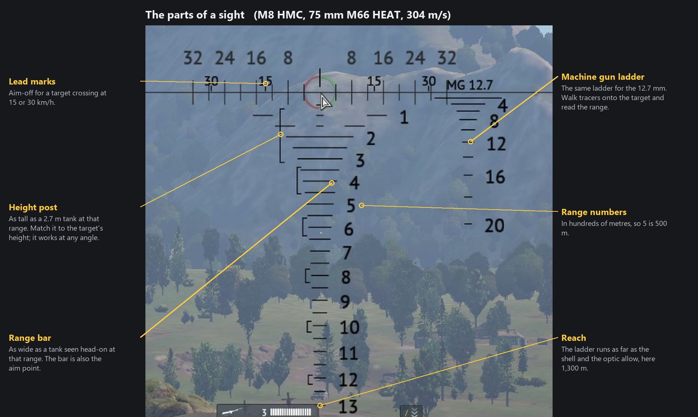
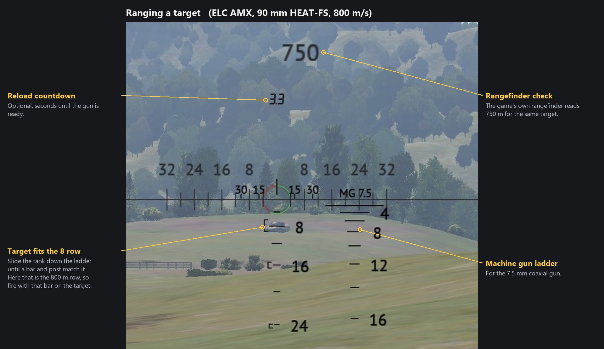
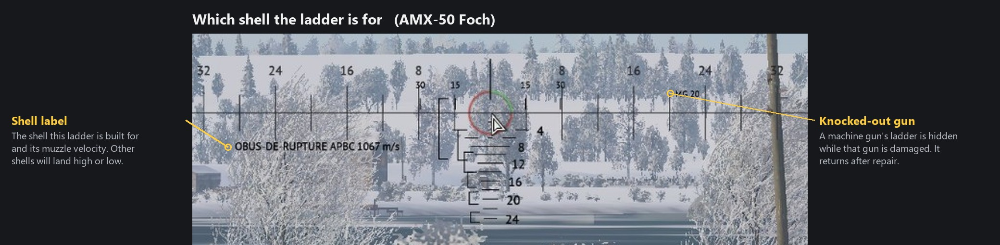

# War Thunder ranging sights

Custom gunner sights for every ground vehicle in War Thunder that has a gun:
1,168 of them, each built from the game's own data for that vehicle's best
shell. One double-click installs them and selects the right sight on every
vehicle.

They use the game's built-in custom sight feature (the same one behind the
sights shared on WT Live). Nothing here touches the game client.



## How to use it



1. Put the target under the ladder and slide it down until a bar is as wide
   as its hull, or a post is as tall as the tank.
2. Read the number on that row. That is the range in hundreds of metres.
3. Fire with that row's bar on the target. No range dial needed.

If the tank is turned, it will look wider than it is. Go by the height post.



## What a sight shows

- **Range ladder.** A column of bars under the aim point, one per range step,
  numbered in hundreds of metres. Each bar is as wide as a 3.4 m tank seen
  head-on at that range. Slide the target down until a bar just covers its
  hull; that row is your aim point.
- **Height posts.** Beside the numbered rows, a small post as tall as a 2.7 m
  tank at that range. Height does not change with the angle the target is
  facing, so trust the post over the bar when a tank is turned.
- **Machine gun ladder.** A second ladder to the right for the vehicle's
  largest machine gun. Walk tracers onto the target, read the row level with
  it, then use that range on the main ladder.
- **Lead marks.** Ticks at 15 and 30 km/h for a target crossing at right angles.
- **Shell label.** The shell the ladder is built for, with its muzzle velocity,
  left of the ladder. A ladder is only correct for that shell.

The row spacing adapts to the gun: 50 m rows for slow howitzers, 400 m rows
for fast, flat shells seen through low-magnification optics.

## Install

Windows only. No extra software is needed.

1. Download this repository (Code > Download ZIP) and unzip it.
2. Close War Thunder completely.
3. Double-click one of:
   - `Install - with reload indicator.bat` to also turn on the gun-ready mark
     and reload countdown on every vehicle
   - `Install - without reload indicator.bat` for the sights only
4. Start the game.

Run the other installer later to switch between the two. Run `Uninstall.bat`
to remove everything again.

### What the installer changes

For each account folder under
`Documents\My Games\WarThunder\Saves\<id>\production`:

- copies the sight files into `UserSights\<vehicle>\ranging_*.blk`
- edits `global.blk`, the game's local settings file, so each vehicle's Sight
  settings entry selects its ranging sight

Things to know before you run it:

- **A backup is made first**, as `global.blk.bak-<date>-<time>` beside the
  original. To undo by hand, close the game and copy the backup over
  `global.blk`.
- **Editing `global.blk` is not a documented feature.** It changes the same
  setting as the in-game Sight settings screen, and has worked in testing, but
  the game could change how it stores this.
- **Your own sights are left alone.** A vehicle where you already picked a
  different custom sight keeps it. Vehicles using a ranging sight are reset to
  the colours and positions built into the installer.
- **The game must be closed**, because it rewrites `global.blk` when it exits.
  The installer refuses to run while the game is open.

### Picking a sight by hand

If you would rather not have the settings file edited, copy the folders from
`sights` into `UserSights` yourself, restart the game, and choose the
`ranging_...` entry in Sight settings > Reticle for each vehicle.

## Limits

- **One shell per vehicle.** The sight is built for the shell with the highest
  penetration that the vehicle can load. Firing a shell with a noticeably
  different velocity through it will miss high or low. `sights\manifest.csv`
  lists the shell chosen for every vehicle.
- **95 vehicles have no sight**: missile carriers, rocket launchers and SAM
  systems, which have nothing to range.
- **Vehicles with two main guns** get a ladder for the first gun only.
- **Width ranging reads short on angled tanks.** Use the height posts.
- **Tank sizes vary.** The 3.4 m width and 2.7 m height are typical values, so
  expect ranges to be off by 10 to 15 percent on unusually large or small
  targets.
- **A knocked-out gun loses its ladder.** The game stops drawing the machine
  gun ladder while that gun is damaged, leaving only its "MG" label. It comes
  back once the gun is repaired.
- **Only a handful of vehicles have been checked in battle.** Autocannons and
  anti-aircraft guns are the least tested.
- **Game updates** can add vehicles or change shells. The sights then need
  regenerating (below).

## Regenerating the sights

Needs Python 3 and an internet connection. Shell data comes from the public
[War Thunder datamine](https://github.com/gszabi99/War-Thunder-Datamine).

```
python batch.py --release
```

This rebuilds `sights\` and `sights\manifest.csv`. Delete the `cache` folder
first to pick up a new game version. To force a particular shell for a
vehicle, create `overrides.json`:

```
{"ussr_t_54_1947": "100mm_br_412b"}
```

`python make_sight.py <vehicle id>` builds a single sight and prints the
shells that vehicle can load.

## How it works

The game computes where each range tick sits; a sight file only names a shell
(type and muzzle velocity) and says which ticks to draw and how wide. The
generator reads each vehicle's gun, shells, optic field of view and machine
guns from the datamine and lays the ladder out to suit. Height posts are
free-drawn lines, so their positions come from a drag calculation using the
game's own mass, calibre and drag values.

The details of the sight file format that the generator relies on were worked
out by measuring in-game screenshots; they are noted in the comments of
`make_sight.py`.
